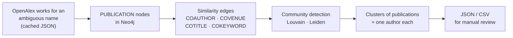

# Research on Author Name Disambiguation

Graph-based author name disambiguation for scholarly publication data. Given every publication attributed to an ambiguous author name (for example, "David Nathan"), this project builds a **publication similarity graph** in Neo4j and applies **community detection** (Louvain and Leiden) so that each resulting cluster ideally corresponds to one real person.

This repository contains the Fall 2025 work of the Name Disambiguation subgroup.

---

## Table of contents

- [The problem](#the-problem)
- [Approach](#approach)
- [Repository contents](#repository-contents)
- [Input data format](#input-data-format)
- [Graph model](#graph-model)
- [Clustering methods](#clustering-methods)
- [Setup](#setup)
- [Usage](#usage)
- [Outputs](#outputs)
- [Test data: `openAlex_Idssame.csv`](#test-data-openalex_idssamecsv)
- [Known issues and limitations](#known-issues-and-limitations)
- [Contributors](#contributors)

---

## The problem

Bibliographic databases attribute publications to author *names*, and names are ambiguous in two directions:

- **One name, many people (homonyms).** Several different researchers publish as "D. Nathan".
- **One person, many names (synonyms).** The same researcher appears as "David M. Nathan", "D. M. Nathan", and "David Nathan".

If these are not resolved, any downstream analysis (citation counts, collaboration networks, research-community maps) silently merges unrelated people or splits one person into several. The included test file shows the scale of the problem for a single surname: in OpenAlex, the name variant "D. Nathan" alone maps to 976 distinct author IDs (see [Test data](#test-data-openalex_idssamecsv)).

## Approach

The core assumption is that publications written by the same person resemble each other: they share co-authors, appear in the same venues, have related titles, and cover the same topics. So instead of comparing names, we compare **publications**:



1. **Ingest.** Load cached publication metadata (produced by an upstream fetch script, `neo4j_data.py`, which is not in this repository).
2. **Build the graph.** Create one `PUBLICATION` node per work, then connect pairs of publications by evidence that they share an author: shared co-authors, the same venue, similar titles, and shared keywords.
3. **Cluster.** Run community detection on the weighted graph. Densely connected groups of publications are taken as the work of a single person.
4. **Review.** Export clusters to JSON and CSV, with size statistics, so results can be checked by hand against ground truth.

## Repository contents

| File | What it is |
|---|---|
| `neo4j_import.py` | Main import script, updated to run on a multi-author dataset. Adds keyword data and the `COKEYWORD` edge, uses GDS Louvain, and includes in-progress NetworkX/igraph clustering helpers. |
| `neo4j_import_leiden.py` | Import pipeline (single-author dataset) plus Leiden clustering through the Neo4j Graph Data Science (GDS) library, with optional merging of small communities. |
| `neo4j_external_leiden.py` | Import pipeline plus Leiden clustering through the external `leidenalg` library using the Constant Potts Model, with adaptive resolution selection and CSV export. The most complete clustering pipeline in the repository. |
| `openAlex_Idssame.csv` | Test data: name variants around "David Nathan" and the OpenAlex author IDs associated with each variant. |

The three scripts share the same `Neo4jImportData` class design and differ mainly in their data format and clustering backend.

## Input data format

All scripts read a cached JSON file (default path under `cache/`). Two shapes are supported, depending on the script.

**Single ambiguous name** (`neo4j_import_leiden.py`, `neo4j_external_leiden.py`), for example `cache/David Nathan_data.json`:

```json
{
  "works_data": {
    "W123": {
      "id": "W123",
      "title": "Paper title",
      "year": 2019,
      "venue": "Journal name",
      "authors": [{"id": "A5113797452", "name": "David M. Nathan"}, {"id": "A50...", "name": "..."}]
    }
  }
}
```

**Multiple names with keywords** (`neo4j_import.py`), for example `cache/all_authors_data.json`. Publications are grouped under each author name, and each work carries a `keywords` list:

```json
{
  "authors": {
    "David Nathan": {
      "works_data": {
        "W123": {
          "id": "W123", "title": "...", "year": 2019, "venue": "...",
          "authors": [{"id": "...", "name": "..."}],
          "keywords": [{"id": "K1", "name": "diabetes"}]
        }
      }
    }
  }
}
```

## Graph model

### Nodes

| Label | Properties |
|---|---|
| `PUBLICATION` | `id`, `title`, `year`, `venue`, `authors` (JSON string of `{id, name}` objects), `keywords` (list of names; `neo4j_import.py` only) |

### Edges

Each edge type encodes a different signal that two publications may share an author. Edges are created between every qualifying pair of publications.

| Type | Created when | Edge properties | Signal |
|---|---|---|---|
| `COAUTHOR` | The two works share at least one `(author id, name)` pair | shared authors, `weight` = number of shared authors | Strongest: people tend to keep collaborating with the same co-authors |
| `COVENUE` | The two works have the same venue | `venue` | Researchers tend to publish in the same journals and conferences |
| `COTITLE` | Titles are similar under TF-IDF cosine similarity (1-2 word n-grams, English stop words removed); each paper links to its top `k=5` most similar papers above a similarity of `0.35` | `similarity` | Topical continuity across a person's work |
| `COKEYWORD` | The two works share at least `min_shared = 3` keywords (`neo4j_import.py` only) | shared keywords, `weight` = number shared | Topical overlap, finer-grained than titles |

Edges are stored as directed relationships, but every clustering method treats the graph as **undirected**, either through a GDS projection with `orientation: 'UNDIRECTED'` or by collapsing duplicate edges in igraph (`as_undirected(mode="collapse", combine_edges="sum")`).

Reported example size, from the script docstring: for "David Nathan", the `COAUTHOR` and `COVENUE` graph had **413 nodes and 22,953 relationships** (17,840 `COAUTHOR`, 5,113 `COVENUE`).

## Clustering methods

Three clustering approaches were explored.

### 1. Louvain through Neo4j GDS (`neo4j_import.py`)

`apply_louvain_clustering()` projects the publication graph into GDS memory, streams Louvain community assignments, and reports community sizes and **modularity**. Louvain greedily maximizes modularity: the density of edges inside communities relative to what a random graph with the same degrees would have.

### 2. Leiden through Neo4j GDS (`neo4j_import_leiden.py`)

`apply_leiden_clustering(gamma, theta, merge_small, min_size)` runs GDS Leiden. Leiden improves on Louvain by guaranteeing that communities are internally connected (Louvain can produce badly connected communities).

- `gamma`: resolution. Higher values produce more, smaller communities.
- `theta`: randomness in the refinement step.

The script's `__main__` compares two configurations: a baseline (`gamma=1.0`, no merging) and a coarser one (`gamma=0.5`, with small communities merged, `min_size=5`).

### 3. Leiden with the Constant Potts Model through `leidenalg` (`neo4j_external_leiden.py`)

This pipeline exports the graph from Neo4j into an `igraph.Graph` and runs `leidenalg` with `CPMVertexPartition` (the Constant Potts Model), which the code notes was the best-performing partition type in the group's prior research.

**Edge weights.** When exporting, `COAUTHOR` edges use the number of shared authors, `COTITLE` edges use the cosine similarity, and `COVENUE` edges use 1.0. Parallel edges between the same pair of publications are summed, so two papers with shared co-authors, the same venue, and similar titles end up strongly linked.

**Why CPM.** Modularity has a known *resolution limit*: it cannot detect communities below a scale that depends on the size of the whole graph, so small but real clusters (an author with only a few papers) get absorbed into larger ones. CPM measures community quality against a fixed density threshold (the resolution parameter γ) instead of a graph-wide null model, so it does not suffer from this limit. This matters for disambiguation, where many true authors have very few publications.

**Adaptive resolution selection** (`_find_optimal_resolution`). CPM's output depends heavily on γ, so the script selects it automatically:

1. **Coarse search.** Run CPM Leiden at γ = 0.1, 0.2, ..., 1.0 and record the number of clusters at each value.
2. Find the interval with the **largest jump** in cluster count, where the partition starts to fragment.
3. **Fine search.** Scan that interval in steps of 0.01 and again find the largest jump.
4. Return the γ immediately **before** the spike: the most detailed partition before clusters start shattering into fragments.

**Small-community merging** (`merge_small=True`). After clustering, every community smaller than `min_size` is scored against each larger community by `(edges between them) / (size of the small community)`. It merges into the best-scoring large community if that score exceeds 0.5; otherwise its publications go into a single "orphan" group. `neo4j_import_leiden.py` implements the same logic with Cypher edge counts; `neo4j_external_leiden.py` uses igraph neighbor sets, which is much faster.

**Reporting.** `print_community_statistics()` reports the total, average, median, and range of cluster sizes, plus a size distribution (singletons, 2-5, 6-20, >20). `export_communities_to_csv()` writes one row per publication for manual review.

## Setup

**Requirements**

- Python 3.9+
- A running [Neo4j](https://neo4j.com/) instance (Neo4j Desktop works well locally)
- The [Graph Data Science (GDS)](https://neo4j.com/docs/graph-data-science/current/) plugin installed in that instance, for the GDS Louvain and Leiden methods

**Python packages**

```bash
pip install neo4j scikit-learn python-igraph leidenalg
```

`scikit-learn` is needed for `COTITLE` edges, and `python-igraph` and `leidenalg` for the external Leiden pipeline. Both are imported optionally: if they are missing, the corresponding step prints a warning and is skipped.

## Usage

1. Start Neo4j and install the GDS plugin.
2. Produce the cached JSON for your author name(s) with the upstream fetch script, and place it under `cache/`.
3. Edit the connection settings in the `__main__` block of the script you want to run:

   ```python
   URI = "neo4j://127.0.0.1:7687"
   USER = "neo4j"
   PASSWORD = "<your password>"
   DB = "neo4j"
   PATH = "cache/David Nathan_data.json"
   ```

4. Run the script from the repository root:

   ```bash
   python neo4j_external_leiden.py   # recommended: CPM Leiden + auto-resolution + CSV export
   python neo4j_import_leiden.py     # GDS Leiden, baseline vs. merged comparison
   ```

> **Warning:** every script calls `delete_all_nodes()` first, which runs `MATCH (n) DETACH DELETE n` and **wipes the entire target database**. Point the scripts at a dedicated database.

To customize the pipeline, call the methods directly:

```python
imp = Neo4jImportData(URI, USER, PASSWORD, DB, PATH)
imp.delete_all_nodes()
imp.publication_as_nodes()
imp.add_covenue_edge()
imp.add_coauthor_edge()
imp.add_cotitle_edge(min_similarity=0.35, top_k=5)

communities = imp.apply_external_leiden_clustering(
    auto_resolution=True,   # or pass resolution_parameter=0.3
    merge_small=True,
    min_size=3,
    seed=42,                # for reproducible runs
)
Neo4jImportData.print_community_statistics(communities)
Neo4jImportData.export_communities_to_csv(communities, "clusters.csv")
imp.close()
```

## Outputs

Results are written next to the input file in `cache/`:

| Script | Output files |
|---|---|
| `neo4j_import_leiden.py` | `<name>_communities_baseline_gamma1.0.json`, `<name>_communities_merged_gamma0.5_min5.json` |
| `neo4j_external_leiden.py` | `<name>_communities_external_auto.json`, `<name>_communities_external_auto.csv` |

JSON maps each community ID to its publications (`{"id", "title"}`). The CSV has the columns `cluster_id, cluster_size, publication_id, title`, sorted by cluster size, for side-by-side manual review.

## Test data: `openAlex_Idssame.csv`

This file records how OpenAlex resolves the name variants around "David Nathan". Each row is a name string and the list of OpenAlex author IDs that the name maps to:

| Name variant | Distinct OpenAlex author IDs |
|---|---|
| D. Nathan | 976 |
| David Nathan | 156 |
| D. M. Nathan | 29 |
| David M. Nathan | 10 |
| Dev Nathan | 7 |
| S. David Nathanson | 7 |
| David S. Nathan | 3 |
| David Matthew Nathan | 1 |

Two observations motivate the project:

- **Abbreviated names are highly ambiguous.** "D. Nathan" covers hundreds of possible people, so the name string alone carries almost no identifying information.
- **Even existing IDs are noisy.** The single ID for "David Matthew Nathan" (`A5113797452`) also appears under every other "David Nathan" and "D. Nathan" variant, and under "Dev Nathan". Overlaps like this suggest that the database's own author records split and merge people inconsistently, which is why the clustering here works from publication evidence rather than trusting existing author IDs.

The file serves as a test set for checking whether the clustering separates people correctly across similar names.

## Known issues and limitations

This is research code, and several parts are still in progress. Known issues found while documenting:

**`neo4j_import.py` does not currently run end to end**

- `nx`, `ig`, `la`, and `community_louvain` are used but never imported.
- `run_leiden`, `run_louvain`, and `load_pub_graph_from_neo4j` are indented inside the class without a `self` parameter, but are called as module-level functions in `__main__`; `load_pub_graph_from_neo4j` also references `self.driver`.
- `__main__` uses undefined names (`uri`, `user`, `password`, `db`, `method`). The previously working pipeline is preserved in the commented-out block at the bottom of the file.
- In `load_pub_graph_from_neo4j`, `COKEYWORD` edges fall into the `ELSE 0.0` branch of the weight query, so they are dropped despite the `cokeyword_scale` parameter.
- In `add_coauthor_edge`, the weight is `len(json_string)` (the length of the serialized string) rather than the number of shared authors, and `list(json_string)` stores a list of characters. `add_keyword_edge` has the same `list(json_string)` issue, and its docstring says "at least two" keywords while the default is 3.
- The GDS Louvain projection requests the `weight` and `similarity` properties on `COTITLE`, which only has `similarity`.

**Across the scripts**

- `COVENUE` connects publications with a missing venue to each other: `None == None` matches in the Leiden scripts, and in `neo4j_import.py` the venue is converted with `str()`, so a missing venue becomes the truthy string `"None"`.
- GDS Leiden in `neo4j_import_leiden.py` projects edge properties but does not pass `relationshipWeightProperty`, so it clusters an **unweighted** graph.
- Edge construction compares every pair of publications (O(n²)) and sends one Cypher query per edge. This is fine for hundreds of publications but slow for thousands; batching with `UNWIND` would help considerably.
- `COVENUE` is very dense (every pair of papers in a popular journal is linked) and can dominate clustering; down-weighting it relative to `COAUTHOR` is worth testing.
- Connection credentials are hard-coded in `__main__`. Reading them from environment variables would be safer.
- The upstream fetch script (`neo4j_data.py`) that produces the cached JSON is not included in this repository.

**Next steps**

- Evaluate clusters quantitatively against ground truth (for example, pairwise precision, recall, and F1, or B-cubed) instead of by manual review alone.
- Fix the issues above and consolidate the three scripts into one pipeline with a choice of clustering backend.
- Tune the relative weights of the edge types.

## Contributors

Name Disambiguation subgroup, Fall 2025. From the commit history:

- **Sihan (Sophia) Wang** ([@sophiawang85](https://github.com/sophiawang85)): repository setup, the OpenAlex name-variant test data, and the multi-author version of `neo4j_import.py` (keyword data, `COKEYWORD` edges, and running on the group's dataset).
- **Rohan Bhosale**: the initial `neo4j_import.py` and the Leiden clustering scripts (`neo4j_import_leiden.py`, `neo4j_external_leiden.py`).

The CPM partition choice and the adaptive resolution algorithm build on prior research by Mikaela, credited in the code.
